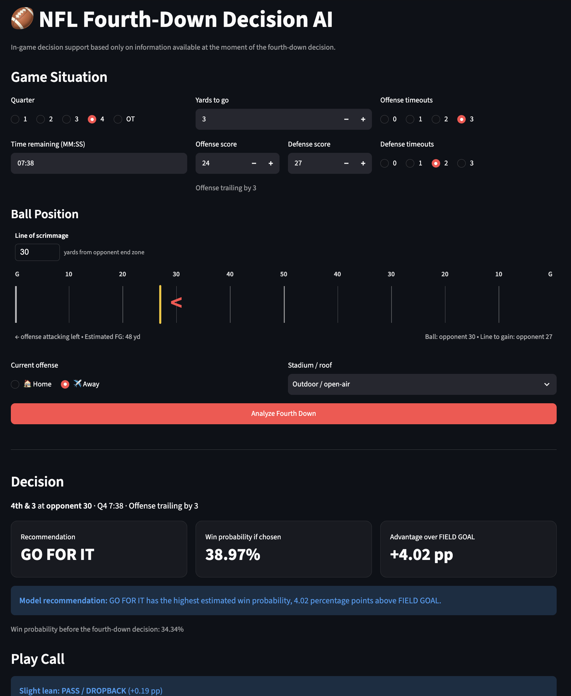

# Fourth Down AI

[](https://github.com/daniel-jpg/fourth-down-ai/actions/workflows/tests.yml)
[](https://github.com/daniel-jpg/fourth-down-ai/actions/workflows/render_public_browser_smoke.yml)
[](https://fourth-down-ai-nfl.onrender.com/)
[](https://www.python.org/)
[](LICENSE)

An NFL fourth-down decision engine that compares **go for it, field goal, and punt** decisions using machine learning, empirical transition models, and Monte Carlo simulation.

The project supports regulation, 2025+ NFL regular-season overtime, and postseason overtime, with an interactive Streamlit interface.

## Live Demo

[Launch the NFL Fourth-Down Decision AI](https://fourth-down-ai-nfl.onrender.com/)

**Render Free deployment (October 12, 2026):** The official frozen-model
fourth-down calculator is live at the URL above. A real public Chromium test
verified the source fingerprint, weather controls and a **Q4 HOME
recommendation**, plus 32°F/25 mph Snow, Rain and wind-direction research
comparisons. The [complete hosted Chromium smoke #38315221787](https://github.com/daniel-jpg/fourth-down-ai/actions/runs/38315221787)
**PASSED** on the exact Render URL, including invalid METAR rejection,
international venue context, and covered-roof behavior.
On the Free plan the service can sleep after 15 minutes of inactivity and
take time to wake, and Q4 calculations can take tens of seconds.

[Render public browser checks](https://github.com/daniel-jpg/fourth-down-ai/actions/workflows/render_public_browser_smoke.yml) ·
[Hosted reliability issue and evidence](https://github.com/daniel-jpg/fourth-down-ai/issues/11) ·
[Legacy Streamlit Community Cloud mirror](https://fourth-down-ai.streamlit.app/) (intermittently unreliable).
The **Tests** badge verifies offline model and application code only;
the public browser smoke is a separate verification of the hosted website.

## Portable Docker fallback

Streamlit Community Cloud has shown intermittent startup failures even
though the [independent local Chromium test](https://github.com/daniel-jpg/fourth-down-ai/actions/runs/38306046798)
completed a real Q4 HOME calculation in 6.05 seconds. To preserve a
hosting-independent option, the repository now contains a production
`Dockerfile` using the **same frozen model artifacts and simulation logic**.

```sh
docker build -t fourth-down-ai .
docker run --rm -p 8501:8501 --memory=1g fourth-down-ai
```

Then open `http://localhost:8501`. Streamlit also serves a health probe at
`/_stcore/health`. Container hosting can use its own `PORT` setting;
the process runs without root privileges. The build excludes local secrets,
raw/evaluation/prospective play data, and unreviewed candidate models.

[Portable Docker browser QA](https://github.com/daniel-jpg/fourth-down-ai/actions/workflows/portable_docker_streamlit.yml)
builds the image and tests a full Q4 HOME recommendation in Chromium.
The same image is deployed on the [Render Free service](https://fourth-down-ai-nfl.onrender.com/).
Core Q4 and weather what-if calculations have been observed in a public browser.
The legacy Streamlit Community Cloud website is not proven healthy;
see [Issue #11](https://github.com/daniel-jpg/fourth-down-ai/issues/11).

## Render Free hosting

The deployment is **[fourth-down-ai-nfl.onrender.com](https://fourth-down-ai-nfl.onrender.com/)**,
matching the requested hostname. It uses a **512 MB Free instance**;
automatic deployments are disabled, and no paid plan was created.
Q4 calculations work, but can take noticeably longer than our 1 GiB
Docker tests. Weather is an **experimental FG-only what-if** and never
changes the official action recommendation; prospective 2026/2027
validation has not been unlocked.

The Free tier sleeps after inactivity and the workspace's 750 free
instance-hours/month are shared across services. As of October 12, 2026,
the connected Render workspace lists **only fourth-down-ai-nfl**; older
Fourth-Down AI services are no longer present.

[Free hosting operation and cleanup](docs/render_hosting.md) ·
[Actual public Q4 and weather browser tests](https://github.com/daniel-jpg/fourth-down-ai/actions/workflows/render_public_browser_smoke.yml).


## Demo



## At a glance

Fourth Down AI asks a practical question: **given the score, clock, field position and timeouts right now, which available fourth-down action has the highest *modeled* chance of winning?** It estimates each eligible action's immediate outcome, simulates the resulting game states, and compares their downstream win probabilities (or overtime game values). The model is decision-support research, **not a causal proof** that a coach should follow a particular play.

**Try a representative scenario:** Q4, 7:38 remaining, trailing 24–27, fourth-and-3 at the opponent's 30-yard line, with three timeouts for each team. The current corrected-Q4 research demo estimates **GO FOR IT: 41.53%** (RUN), **PASS: 41.06%**, **FIELD GOAL: 35.20%**, and **PUNT: 22.11%**. Its **+6.33-percentage-point *model-estimated* advantage** for GO versus FG and the small RUN/PASS separation were reproduced in the [real-engine QA matrix](https://github.com/daniel-jpg/fourth-down-ai/actions/runs/38199827967). These are fixed-input illustrative estimates, not observed NFL outcomes, causal advice, or proof of prospective calibration.

**What makes the project distinctive:** action-specific GO/FG/punt outcome models, realistic sampled next-state transitions, adaptive Monte Carlo comparison, rule-aware overtime handling, and separate, reproducible 2025 kickoff research in the repository (not the public app). Open **Why this recommendation? Immediate action odds** in the app to see conversion and kick-outcome assumptions separately from overall game value.

**Evidence at a glance:** The frozen v1.1.0 2025 benchmark includes WP AUC **0.81781**, GO conversion Brier **0.22817**, and FG Brier **0.10931** (see [full benchmark](#held-out-2025-snapshot)). [CI #252](https://github.com/daniel-jpg/fourth-down-ai/actions/runs/38199827967) passed **328 regression tests, 45 Streamlit integration tests, and 15 additional real-engine situation audits**, spanning regulation, endgame and regular/postseason overtime. The extra audits check mathematical consistency, model support and software operation, **not actual-game calibration or causal coaching effectiveness**. Later 2025 explorations are no longer untouched holdouts; the [precommitted 2026 test](reports/2026_native_kickoff_challenger_protocol.md) remains gated.

**Explore:** [Live demo](https://fourth-down-ai.streamlit.app/) · [How it works](#how-it-works) · [Evaluation](#data-and-evaluation-design) · [Limitations](#limitations) · [Research-demo readiness](reports/88_research_demo_release_readiness.md)

## Features

- Compares go-for-it, field-goal, and punt decisions
- Separately evaluates pass/dropback and run attempts
- Estimates downstream win probability in regulation and game value in overtime
- Uses action-specific conversion, field-goal, punt, and win-probability models
- Uses empirical transition pools for realistic post-play states
- Supports adaptive Monte Carlo evaluation for close decisions
- Preserves punt touchbacks as a discrete receiving-team own-20 outcome
- Supports field-goal attempts through 70 yards with explicit sparse-support warnings
- Supports regular-season and postseason overtime
- Keeps fake punts and fake field goals experimental and out of production recommendations
- Includes automated regression and policy smoke tests
- Includes a Streamlit web app for interactive use

## How It Works

For each fourth-down situation, the engine:

1. **Normalizes the game state**
   - Quarter and clock
   - Score
   - Field position
   - Yards to go
   - Timeouts
   - Home / away / neutral site
   - Stadium / roof
   - Overtime format and possession phase when applicable

2. **Checks action eligibility and support**
   - Unsupported or out-of-range actions are marked unavailable
   - Long field goals receive explicit support warnings

3. **Models action outcomes**
   - GO decisions use action-specific conversion models
   - Field goals model makes, misses, blocks, and broken plays
   - Punts model field position, clock runoff, touchbacks, and rare transitions

4. **Simulates post-play game states**
   - Each eligible action produces a distribution of possible next states

5. **Evaluates continuation value**
   - Regulation uses win probability
   - Overtime uses game value with rule-aware terminal handling

6. **Compares actions with Monte Carlo simulation**
   - Non-Q4 periods begin with 300 simulations per eligible action and rerun from scratch with 1,200 if the estimated top-action gap is too close relative to simulation noise
   - Regulation Q4 uses the isolated native standard-35 kickoff-input correction and 1,200 simulations per eligible action directly, without a second comparison panel

The displayed Monte Carlo standard error measures simulation noise only. It does not represent total model uncertainty.

## Optional temperature, wind and weather context (research-only)

The [public Streamlit app](https://fourth-down-ai-nfl.onrender.com/) has **two
optional, initially empty fields** under **Weather observations (optional)**:
temperature (°F) and wind speed (mph). Enter values directly, without
enabling a checkbox. Leave either field blank to skip the experimental
comparison; both are required to run it. The normal recommendation works
with no weather values. These fields are hidden for closed-roof games.
No paid weather API, precipitation selector or wind-direction selector
is part of the public interface.

These inputs drive a separate **Weather-adjusted field goal comparison
(experimental)**, NOT the official win-probability ranking. The
[2014–2024 historical FG weather ablation](reports/weather_fg_experimental_manual_inputs.md)
used 5,705 training kicks and 1,186 validation kicks; while wind had a
negative fitted association with FG makes, **the weather-enhanced model
slightly worsened held-out Brier score (0.102114 vs 0.102068)**. Therefore
the weather candidate is not approved for production. The comparison
runs in a [per-session isolated frozen-engine namespace](src/weather_fg_sensitivity.py)
and only adjusts the clean FG make/miss sensitivity. It does not model
wind direction, rain/snow effects, pass/run/punt weather response, or
actual pre-snap weather provenance. The official frozen model, 2026
one-time gates and 2027 future holdout remain unchanged.

**Historical GO/PUNT weather evidence is now available:** the
[2014–2024 identical-cohort study](reports/weather_go_punt_2014_2024_findings.md)
tested observed GO conversion and recorded gross PUNT distance. Adding
temperature/wind **worsened GO conversion validation Brier** from 0.216460
to 0.216981; for PUNT it changed gross-distance MAE from **6.3704 yards
to 6.3396 yards**, an inconclusive 0.031-yard improvement with a
game-cluster interval crossing zero. Parsing rain/snow words from
game-level historical weather text did not meaningfully improve these
results. The original source exposes **wind speed but no verified
play-relative direction**, so there is no Headwind/Tailwind/Crosswind
selector in the public app.
These exploratory comparators are not the deployed models and cannot
justify promoting weather into the official GO/PUNT strategy ranking.

### Timestamped NOAA airport weather evidence (optional, research only)

A separate [NOAA METAR source collector](scripts/capture_awc_decision_weather.py)
can now make a one-shot recent **airport** weather request (or read an offline
JSON fixture), strictly check original report and NOAA receipt timestamps
against a supplied football decision time, reject stations beyond **30 km**
or observations older than **90 minutes**, and archive SHA-256 source evidence.
The [physics and source-quality module](src/metar_decision_weather.py)
decomposes wind reported **FROM true north in knots** into offense-relative
headwind/tailwind and signed crosswind, but only with a separately supplied
physical field attacking bearing. Variable wind remains unknown. Coded rain
or snow is an airport present-weather observation, not measured rainfall
at the football field. A late download is labeled retrospective, never
an independently witnessed live-game forecast.

The NOAA/METAR tools remain **offline research utilities** in the
repository, but their airport-report viewer was removed from the public
fourth-down app because it has no effect on predictions. The saved source
receipts are unsigned and not independently authenticated. The
[complete capture protocol and remaining field-sensor requirements](reports/weather_decision_time_noaa_metar_evidence.md)
describe the limitations. The dedicated
[offline synthetic CI](.github/workflows/metar_weather_evidence.yml)
continues to test source integrity and age/distance guards independently
of the main UI. Real signed on-field wind vectors and precipitation
intensity are still needed for a validated weather-aware recommendation.

A [real NOAA API schema smoke test](https://github.com/daniel-jpg/fourth-down-ai/actions/runs/38292972017)
**passed on October 12, 2026**, retrieving a genuine KSEA airport report
after introducing a tightly bounded second try for a transient HTTP read
timeout. The [deterministic offline checks](https://github.com/daniel-jpg/fourth-down-ai/actions/runs/38292941260)
also passed **28 tests**, including a published NOAA response-format example
and no-retry guards for blocked or empty responses. The live trial used
**the airport itself as a fake football field** with an invented heading,
so it certifies API compatibility—not an actual NFL stadium or validated
on-field weather. [See exact timing and evidence limits](reports/weather_decision_time_noaa_metar_evidence.md).

### 2026 NFL stadium compass lookup (research only)

The repository's **offline research dataset** includes 2026 stadium
geometry by physical venue, from a pinned community geographic reference:
**32 approximate team-venue centers, 31 community-estimated field
axes**. The replacement 2026 Buffalo stadium center is mapped from
OpenStreetMap-derived evidence at approximately **42.77304, -78.79219**
and crosschecked to another map reference. **Populous (the stadium
architect) and an independent Associated Press report now establish a
qualitative north–south field orientation**, but the exact new-stadium
true-north azimuth remains **unsurveyed/unverified** and deliberately NULL;
no numerical headwind/crosswind is inferred. The original
community source still contains the retired stadium location. Tennessee's
2026 stadium map does not carry forward to its planned 2027 replacement.
[Full source provenance and venue-year caveats](reports/2026_nfl_stadium_weather_geometry.md).

Stadium and attack-direction tools are no longer displayed in the public
decision app; they could not verify on-field wind and do not affect odds.
For separate research, use the
[one-shot venue-to-NOAA command-line collector](scripts/capture_nfl_venue_awc_context.py).
It needs an independently confirmed actual venue and offense attack
direction, makes **no automatic NOAA request** from the public app, and
never changes official action probabilities. Venue estimates and actual
roof/attack direction remain **unverified**.

The offline venue reference also includes the NFL's [nine officially
scheduled 2026 international fixtures](src/2026_nfl_international_venue_schedule.json)
across eight foreign stadiums. They **block automatically treating a
team's normal U.S. home venue as the overseas game location**. The
[venue-aware NOAA collector](scripts/capture_nfl_venue_awc_context.py)
now requires an explicit game date and opponent in live mode and
refuses a known international matchup **before making HTTP requests**.
Other nonmatching games remain unverified, rather than presumed
domestic. [Read the venue exception study](reports/2026_nfl_stadium_weather_geometry.md).

Buffalo's weather panel now shows the source-backed **north/south**
end-zone orientation and an optional **specific-play direction claim /
receipt viewer**.
A separate [Buffalo WGS84 field-axis measurement CLI](scripts/measure_buffalo_field_axis.py)
now accepts TWO original, independently sourced, user-supplied **north
and south goal-line (100 yd) or back end-line (120 yd) midpoint**
measurements. It checks NFL playing-field separation, correct new
stadium vicinity, documented north/south orientation, source hash
uniqueness, measured-point uncertainty, and the calculated true-north
bearing. Outputs are explicitly **UNVERIFIED geometry candidates**: no
genuine Buffalo end-zone survey has yet been supplied, no numerical
bearing enters the approved registry, and **no NOAA wind or win-probability
adjustment is enabled**. See [how to provide real physical midpoint
evidence and interpret its uncertainty](reports/buffalo_2026_field_axis_measurement.md).
The [offline evidence CLI](scripts/capture_buffalo_snap_direction_claim.py)
records one or two locally supplied footage/observer witnesses, hashes
their original files, checks direction conflicts and source availability
relative to an explicitly declared decision UTC timestamp, and preserves
only metadata—not the photo/video contents. Source provenance remains
**USER-ASSERTED**, even if two witnesses agree. A source supplied after
the decision is retrospective only, and neither the claim nor its hash
can change the official model. [Research and verification details](reports/buffalo_2026_attack_direction_source_evidence.md).

The [stadium geometry tests](tests/test_nfl_stadium_weather_geometry.py)
and [dedicated synthetic 2026 GitHub workflow](https://github.com/daniel-jpg/fourth-down-ai/actions/runs/38293909282)
passed **87 checks**, including a fake Seattle venue to nearby airport
wind-vector receipt, a blocked second receipt write and model-input
isolation. Protected model artifacts and future-season evaluation gates
are untouched.

## Overtime Support

The engine supports both **regular-season** and **postseason** overtime.

The app lets the user choose:

- **Overtime format**
  - Regular season
  - Playoffs
- **OT possession**
  - Opening possession
  - Response possession
  - Sudden death

The UI applies format-specific clock and timeout rules, and the engine handles possession requirements, scoring transitions, terminal outcomes, clock expiration, and postseason period continuation.

Overtime decisions are evaluated using **game value**:

- Win = 1.0
- Tie at expiration = 0.5
- Loss = 0.0

The overtime rule layer has been stress-tested with direct rule checks, large state sweeps, timeout combinations, regulation regression states, and held-out overtime plays.

## Interactive App

Run the Streamlit interface locally:

```bash
streamlit run app.py
```

The app allows you to specify:

- Quarter and game clock
- Yards to go
- Offense and defense score
- Offense and defense timeouts
- Line of scrimmage
- Home / Away / Neutral site
- Stadium / roof
- Overtime format and possession phase

It displays:

- Recommended strategy
- Expected win probability or overtime game value
- Advantage over the next-best strategy
- PASS vs RUN guidance when GO FOR IT is recommended
- Monte Carlo uncertainty messaging for close decisions
- Action eligibility explanations
- Long-field-goal support warnings
- Detailed model output and comparison charts

## 2025 Kickoff Studies (research files, no public controls)

The Streamlit app has **no** historical 2025 kickoff scenario,
checkbox, or second experimental recommendation. The optional historical
return/onside comparisons are retained separately in the repository,
not in the public decision screen.

The independent retrospective **2025 regular-season Q4 kickoff study**
contains 538 verified nonscoring first possessions (488 ordinary and
50 clean penalty-affected) out of 584 eligible standard-35 kickoffs
(92.1%). Forty-one onside attempts, two actual re-kicks, one return
touchdown, and two unmatched events are not silently treated as
ordinary kickoffs. Sources:
[coverage census](data/kickoff_2025_q4_coverage.json),
[ordinary kickoff pool](data/kickoff_2025_reg_q4_ordinary.csv),
[verified penalty first snaps](data/kickoff_2025_penalty_first_snaps.csv),
[onside first snaps](data/kickoff_2025_onside_first_snaps.csv) and
[return/penalty audit](data/kickoff_2025_penalty_return_coverage.json).

**Separate from these historical scenarios:** the public research demo
**automatically uses corrected native standard-35 kickoff feature inputs
for its Q4 action calculations**, without a checkbox or extra strategy
table. Its original model weights and frozen `v1.1.0` release artifacts
have not been retrained or replaced. The correction is supported by
retrospective evidence, but independent 2026 testing is still pending.
See the [Q4 feature audit](#q4-kickoff-feature-encoding-audit-research)
and [precommitted validation protocol](reports/2026_native_kickoff_challenger_protocol.md).
Fake punts and fake field goals remain outside the ranked actions.

## Readable explanation of the fourth-down recommendation

The decision page now provides a collapsed **"Why this recommendation?
Immediate action odds"** section. It displays the existing engine's
fourth-down pass/run conversion probabilities, FG make/miss/block rates,
and punt regular/block/broken-play probabilities alongside each normal
action's expected game-winning probability and Monte Carlo standard
error. There are no new model estimates or simulation calls: the
explainer parses the frozen engine's returned action details, excludes
ineligible and experimental fake plays, and fails closed on malformed or
non-normalized probabilities.

**Important:** a successful conversion or made kick is an immediate
outcome, **not** the probability of winning the game. Win probabilities
also depend on remaining time, score, field position, possession and
the frozen continuation model. Kicker-specific field-goal strength
defaults to the training-data median unless supplied in the engine.
See [the presentation-only explainer](src/fourth_down_action_explainer.py)
and [its tests](tests/test_fourth_down_action_explainer.py).

**Updated Q4 calculations (research demo):** The public Streamlit app now
uses the existing native standard-35 kickoff-input correction automatically
for regulation Q4, with the *same frozen model weights* and a fixed
1,200-simulation/action budget. Per-request Python function namespaces
share the cached model/transition artifacts read-only, avoiding a second
large engine load while keeping Streamlit sessions isolated. The app recomputes the **action win
probabilities and recommended play**; it does not merely replace a
disclaimer while leaving the older Q4 scores unchanged. No separate
kickoff checkbox or research panel is presented.

When the old-vs-native made-FG input check is materially sensitive, a
short **Close call** note accompanies the model recommendation. These are
still estimated probabilities, not prospectively validated 2026+ coaching
effects. The published stable v1.1.0 model and original precommitted
forward-evaluation protocols remain unchanged.

## Q4 Kickoff Feature-Encoding Audit (Research)

A [14-situation Q4 robustness audit](reports/2025_q4_kickoff_site_model_defect.md)
identified a material issue in the **original** (still official) win-probability
engine: changing only HOME versus AWAY or NEUTRAL can reverse GO versus
FIELD GOAL near 4th-and-3 at opponent 30, down three with 7:38 remaining.
The historical kickoff-pending state uses missing `yardline_100` and
`ydstogo`, unlike the native standard-35 kickoff encoding.

A **private, reversible candidate**, using `yardline_100=35`,
`ydstogo=0`, `down=NaN` for unresolved normal Q4 scoring kickoffs,
eliminated both reversals on the fixed 14-state grid while preserving
the same frozen WP coefficients. The native-only candidate and the
538-transition comparison both favor GO in 14/14 cases; the original
engine favors GO in 12/14. This is a modeling defect investigation,
**not** a validated causal decision rule. Historical 2024/25 made-FG
calibration point estimates improved with a similar encoding, but
their game-cluster uncertainty intervals include no improvement.

The broader [Step 81 retrospective calibration](reports/2023_2025_broad_q4_native_kickoff_calibration.md)
then compared the SAME frozen WP model on **1,617 actual 2023–2025 Q4
post-score kickoffs** across **762 games**, retaining penalty outcomes and
return touchdowns. The native input encoding had lower pooled Brier loss
(**0.11561 to 0.10743**, gain +0.00818, paired whole-game 95% bootstrap
CI **[+0.00264,+0.01398]**). All three years had favorable point
estimates, but individual-year CIs included zero. Crucially, the
**away-kicking-team subgroup was slightly worse** (gain -0.00119).
These seasons were already examined and this does not validate the
counterfactual fourth-down play selection.

**Current Q4 research-demo behavior:** The published `v1.1.0`
classifier weights and full stable release remain frozen. However,
the live `main` Streamlit research demo now automatically runs the
native standard-35 input correction for regulation Q4 in a private
per-request function namespace. Its GO/FG/PUNT **action probabilities
are recomputed**, rather than merely relabeled. Heavy model resources
are shared read-only across calls; the old historical-return and
advanced native-input toggles stay absent.

**What the "Close call" message means:** For eligible fourth-quarter
made-FG scenarios with more than 45 seconds remaining, a deterministic
check compares the original and native input representations of the
**hypothetical kickoff after a made FG**, assuming a five-second kick.
When the *conditional post-FG* WP estimates differ by at least
**5 percentage points**, the app keeps its corrected GO/FG/PUNT
recommendation but adds a short **Close call** caution. This is a
**model-input sensitivity flag**, not a formal confidence interval,
a Monte Carlo tie test, or proof that GO is better than FIELD GOAL.
The original `INCONCLUSIVE` recommendation and lengthy warning
were removed. It neither retrains weights nor consults 2026 outcomes.

For the reproducible 4:59, fourth-and-4 at opponent 6, down 27–31
(AWAY, three timeouts each), a same-seed 1,200-draw comparison found
the model-estimated FG WP changed from **41.91% to 37.00%** and PASS
from **34.42% to 34.34%**, reducing the FG model edge to **2.66 pp**.
This is evidence of a real input-driven calculation change, **not**
prospectively validated coaching value. See the
[numeric regression](scripts/verify_q4_latest_case.py),
[automated UI tests](tests/test_streamlit_app_integration.py),
[model-input guard](src/kickoff_q4_reliability_guard.py) and
[retrospective site analysis](reports/2023_2025_broad_q4_native_kickoff_calibration.md).

**One-time 2026 native-candidate validation is now precommitted.**
The original [Step 66 automatic 2026 Week 6–18 gate](.github/workflows/forward_2026_validation_once.yml)
remains completely unchanged: it evaluates only after at least 100 eligible
completed games and records its frozen research result once. A new
[post-gate companion](.github/workflows/forward_2026_native_challenger_once.yml)
will then **automatically** score the native input encoding directly against
the frozen baseline, including *home-kicker versus away-kicker* paired Brier
differences and game-cluster uncertainty. It will **not fetch 2026 outcomes
until the original report exists**, and it never promotes a model. The entire
scope, source hashes, site-specific support conditions and no-peeking rules
were committed ahead of time in the
[Step 83 validation protocol](reports/2026_native_kickoff_challenger_protocol.md).
No manual script runs are necessary.

See also
[`src/kickoff_q4_native_features_candidate.py`](src/kickoff_q4_native_features_candidate.py),
[Step 80 evaluation](src/80_evaluate_q4_native_kickoff_candidate.py),
[Step 81 analysis](src/81_broader_post_score_kickoff_calibration.py),
and the [initial site-defect report](reports/2025_q4_kickoff_site_model_defect.md).

## Future seasons using the existing nflverse pipeline (no paid live feed required)

**Default next-season research path:** Reuse the existing
[`nflreadpy.load_pbp(...)` data builder](src/01_build_fourth_down_dataset.py)
to reconstruct completed 2027 fourth downs under a separately frozen,
[future-season retrospective validation contract](reports/2027_same_source_nflverse_out_of_time_validation.md).
The existing [weekly, once-only 2026 kickoff gate](.github/workflows/forward_2026_validation_once.yml)
already uses `nflreadpy` without Sportradar or a separate live service;
its reserved outcomes and scheduling protections remain unchanged.

This **requires no vendor email, subscription or live timestamp authority**.
When complete 2027 results are released, a locked post-game scorer can assess
factual-action calibration, model/coach agreement and explicitly qualified
observational comparisons using only reconstructable pre-play features.
Because these forecasts will be computed **after the games** rather than
externally witnessed before the snap, report them as an *out-of-time
retrospective reconstruction on a prospectively reserved season*, not
real-time independently attested pre-snap predictions. The separate
Sportradar/TSA work is an **optional stronger real-time research experiment**,
not a blocker for this existing-data path. No 2027 outcome data have been read.

The [isolated nflverse input reconstructor](src/nflverse_2027_reconstruction.py)
and [new frozen-engine replay adapter](src/nflverse_2027_frozen_policy_replay.py)
now connect the same fourth-down field format to the *existing* registered
300/1,200-trial policy, with no action/final-label lookahead. The
[replay acceptance report](reports/2027_nflverse_to_frozen_policy_dry_run.md)
and [synthetic-only CI workflow](.github/workflows/2027_nflverse_frozen_engine_bridge.yml)
cover Q4's native standard-35 kickoff correction, model provenance,
missing Q2 half-receiver/roof context, source exclusions and holdout denial.
The only executable forecast inputs are **fabricated 2027-shaped games**.
Actual 2027 evaluation stays explicitly blocked until the **entire**
regular season and separate source/completeness approval are available.

The [separate full-season admission verifier](src/postseason_2027_admission.py)
and [one-time post-seal evaluation rehearsal](src/postseason_2027_once_only.py)
now test **all 272** game identities and final margins against a distinct,
fabricated ESPN-shaped reference, enforce the 32-team/17-game schedule,
seal label-free predictions before joining post-game outcomes, and refuse
rerunning an existing output directory. The
[focused CI run](https://github.com/daniel-jpg/fourth-down-ai/actions/runs/38285893397)
passed **23 tests**, replayed the existing **3,151-game independent historical
ESPN score archive**, and confirmed the second evaluation attempt fails.
See the [postseason admission contract](reports/2027_postseason_existing_data_gate.md).
**The synthetic score reference is not actual ESPN evidence; real 2027 data
admission and the permanent one-time release lock are still intentionally
disabled until a reviewed post-season implementation in 2028.**

The [2025 archived NFLverse/ESPN evidence collector](src/nflverse_espn_historical_collection.py)
and [safe source CLI](scripts/collect_nflverse_espn_2025.py)
now verify 272 real **completed 2025 regular-season games** against the
original independently retrieved **3,151-game ESPN historical final-score
archive**, with original PBP hashes, exact field schema hashes, and strict
denial of 2026/2027 data. The [remote once-only Git tag claim mechanism](src/repository_once_claim.py)
is tested on competing local bare-Git clones so a second runner cannot
reuse the same fixed ref; the library **cannot push to GitHub or activate a
real 2027 evaluation tag today**. [Audit and remaining release requirements](reports/2027_same_source_collector_and_git_once_claim.md).
A real future release still needs authenticated 2027 sources, season
completion, approved tag protections and a separately reviewed activation.

The [postseason evaluation rehearsal](src/postseason_2027_once_only.py)
now optionally records a **shared local Git claim after the forecast seal but
before any game-outcome read**. A second fake runner, even from a different
checkout/output directory, cannot evaluate the same fabricated season.
The [read-only GitHub tag protection auditor](scripts/audit_2027_tag_rulesets.py)
and [admin-ready proposal](reports/2027_tag_protection_ruleset_proposal.json)
identify missing/bypassable protections for the future release tag. The
[focused CI run](https://github.com/daniel-jpg/fourth-down-ai/actions/runs/38287998156)
passed **46 tests**. **Actual GitHub tag rulesets are currently absent;
no GitHub rule or real 2027 release ref was installed/created.** See the
[release-readiness status and required admin setup](reports/2027_release_tag_protection_preflight.md).
The separate complete-season provenance and explicit 2028 authorization
remain mandatory before real future-season scoring.

## Independent 2027 Fourth-Down Action-Policy Study

The separate [preregistered 2027 decision study](reports/2027_fourth_down_action_policy_protocol.md)
asks whether action-specific win-probability estimates are calibrated
when NFL teams **actually choose** pass/run, FG or punt, and whether
historical coaching choices offer enough overlap for a cautious
observational one-decision comparison. This is **different from** the
2026 kickoff-input validation and does not replace it.

The [pure offline evaluator](src/fourth_down_policy_study.py) and
[synthetic-only CI tests](tests/test_fourth_down_policy_study.py) are
installed without changing the live app, frozen model or protected 2026
data gates. The future holdout is **2027 regular-season regulation fourth
downs**. A prospective audit requires final 2027 game outcomes,
pre-snap-only features, separate propensity and reward models trained
using seasons no later than 2025, and recorded model/source provenance.
No 2027 outcomes are available yet, and **no causal fourth-down coaching
advantage has been established**.

A [historical-only coach/reward nuisance fit](reports/2027_historical_nuisance_development.md)
and a [synthetic frozen-policy bridge](reports/2027_frozen_policy_bridge_rehearsal.md)
now exist. Importantly, the registered policy is **not** a bare frozen
engine call: Q1–Q3 uses the app's adaptive 300/1,200-trial scheme, and
Q4 uses the isolated native standard-35 kickoff correction at 1,200
trials with seed 43. The bridge verifies the pinned source/assets and
joins policy action probabilities with e(policy|X), mu(policy,X) without
using the actual coach decision or final game result as pre-snap inputs.
Only fabricated policy-decision scenarios have been replayed. Separately, an
[independent ESPN-versus-PBP final-score audit](reports/independent_espn_2014_2025_final_score_audit.md)
matched **3,151 / 3,151** completed 2014–2025 REG game margins with **zero
score mismatches**, covering 47,942 historical fourth-down source rows.
Every verified score margin is preserved in a
[permanent compact archive](data/independent_espn_2014_2025_margin_archive.json)
and can be [replayed offline](src/independent_espn_margin_archive.py).
A separate [official-stadium-reviewed venue audit](reports/historical_relocated_neutral_site_provider_disagreements.md)
finds four ESPN/non-neutral versus nflverse/neutral flag differences;
all four are documented **relocated home-designated games**, not wrong
scores. The source flags remain unchanged and unexpected differences
now fail the audit. These checks verify retrospective outcomes and
physical stadiums only; real decision-time roof, halftime-receiver,
action intent, kicker and forecast-timestamp provenance still need
independent review.

The [retrospective pre-snap field gap inventory](reports/2027_historical_prespnap_data_gap_audit.md)
inspected **47,626 historical Q1–Q4 fourth downs**. Stadium, roof,
clock and field state are populated, but direct second-half receiver
data, trusted source observation/receipt timestamps, and independently
witnessed forecast timestamps are **absent**. The new
[synthetic-only two-key signing rehearsal](reports/2027_decision_time_provenance_and_witness_rehearsal.md)
binds three fabricated data-source feeds to a frozen policy forecast
and verifies separate collector/witness Ed25519 receipts before a
separate fabricated snap timestamp; factual labels can only be joined
after receipt verification. It does **not** certify real NFL snap-time
availability, an external trusted timestamp authority or 2027
prospective performance. A real source-and-witness freeze remains open.

The next [2027 live-feed feasibility and omission-risk review](reports/2027_realtime_nfl_provider_feasibility.md)
identifies **Sportradar NFL Push Pulse** as a candidate subscription (not
connected): its `players_lining_up` messages may carry decision-time
state, but the documented `wall_clock` can refer to the PREVIOUS play.
A strict [FABRICATED Pulse-v7 adapter](src/sportradar_pulse_synthetic_adapter.py)
replays pre-play state to the registered decision engine and existing
two-party forecast-sealing tests, rejecting late/partial/post-play data.
A separate independent-opportunity ledger counts every missing or
invalid fourth down instead of dropping difficult states. This
**does not** imply that the vendor reliably delivers messages before
the actual snap. Paid feed entitlement, externally trusted time,
per-game roof/receiver coverage and authorized real capture remain
unresolved.

For a future, separate model version, the
[shadow historical-data refresh](reports/shadow_historical_development_intake.md)
now rehearses a safe nflverse-based intake **only on the pinned
2014–2025 archive**. It checks the original Git blob before opening any
Parquet rows, replays the independent ESPN final-score check, preserves
separate pre-snap features / actual actions / post-game labels, and
partitions training (2014–22), validation (2023–24), and the **previously
examined** 2025 development season. Outputs are untracked manifests and
separate Parquet tables under artifacts/, not new production models.
An updated 2026/2027 source is explicitly rejected until a new,
independently approved experiment permits it; nflverse does not replace
true pre-snap evidence for the 2027 prospective study.

Passing the original once-only 2026 native-kickoff test may eventually
allow narrowing the phrase *"kickoff inputs not yet validated on future
games"*; even a positive 2027 observational result would not by itself
justify removing all uncertainty about an unchosen FG versus GO decision.

## Installation

Clone the repository:

```bash
git clone git@github.com:daniel-jpg/fourth-down-ai.git
cd fourth-down-ai
```

Create and activate a virtual environment:

```bash
python -m venv .venv
source .venv/bin/activate
```

Install runtime dependencies:

```bash
pip install -r requirements.txt
```

For development and tests:

```bash
pip install -r requirements-dev.txt
```

Run the app:

```bash
streamlit run app.py
```

Run the test suite:

```bash
python -m pytest -q
```

## Project Structure

```text
fourth-down-ai/
├── app.py
├── requirements.txt
├── requirements-dev.txt
├── assets/
│   └── fourth-down-ai-demo.png
├── data/
├── models/
├── tests/
│   ├── test_engine_regressions.py
│   └── test_policy_smoke.py
└── src/
    ├── 01_build_fourth_down_dataset.py
    ├── ...
    ├── 39_build_punt_model.py
    ├── 40_build_fake_models.py
    ├── 41_train_win_probability_model.py
    ├── 42_build_decision_engine.py
    ├── 43_evaluate_2025.py
    ├── 46_audit_overtime_engine.py
    ├── 47_evaluate_validation_calibration.py
    ├── 48_evaluate_policy_simulation_stability.py
    ├── 49_evaluate_strategy_simulation_stability.py
    ├── 50_evaluate_adaptive_vs_4000.py
    ├── 51_evaluate_punt_distribution.py
    └── 52_evaluate_punt_own20_atom.py
```

The numbered scripts document the modeling, auditing, calibration, and validation pipeline used to build the production engine.

## Main Components

### Decision Engine

`src/42_build_decision_engine.py`

Loads the trained models and empirical transition pools, simulates each eligible action, and compares expected game value.

### Web App

`app.py`

Streamlit interface for entering a game situation and viewing the recommended fourth-down decision.

### Held-Out Evaluation

`src/43_evaluate_2025.py`

Reports final 2025 benchmark performance. The 2025 season is reserved for held-out evaluation rather than production tuning.

### Overtime Audit

`src/46_audit_overtime_engine.py`

Tests overtime rules, state validity, timeout behavior, terminal scoring logic, postseason continuation, and regulation regressions.

### Simulation Stability

`src/48_evaluate_policy_simulation_stability.py`

`src/49_evaluate_strategy_simulation_stability.py`

`src/50_evaluate_adaptive_vs_4000.py`

Evaluate Monte Carlo stability and the production adaptive simulation policy.

### Punt Validation

`src/51_evaluate_punt_distribution.py`

`src/52_evaluate_punt_own20_atom.py`

Validate the production punt field-position distribution and the discrete own-20 touchback mass.

## Data and Evaluation Design

The project uses a chronological development and evaluation setup.

- **2014-2022:** primary model-training period
- **2023-2024:** development validation and calibration analysis
- **2025:** held-out benchmark for frozen v1.1.0; later examined in labeled exploratory experiments

The production engine combines:

- Win-probability modeling
- Normal GO conversion modeling
- Field-goal outcome modeling
- Punt field-position and transition modeling
- Empirical transition pools
- Monte Carlo simulation

The 2025 season is intentionally kept out of production calibration and model-selection decisions.

## Held-Out 2025 Snapshot

| Metric | Result |
| --- | ---: |
| WP log loss — all states | 0.53652 |
| WP AUC — all states | 0.81781 |
| GO conversion log loss | 0.64830 |
| GO conversion Brier score | 0.22817 |
| GO conversion AUC | 0.65750 |
| Field-goal log loss | 0.35617 |
| Field-goal Brier score | 0.10931 |
| Field-goal AUC | 0.74792 |

On the fixed 1,000-play held-out policy sample:

- Exact agreement with the historical action: **53.20%**
- Mean model-estimated edge over the historical action: **+1.412 percentage points**
- Decisions with more than a 1-point model-estimated edge: **31.29%**
- Fake-play recommendations: **0**

The policy edge is model-estimated, not an observed causal improvement in win probability.

## Punt Validation

On 2023-2024 validation punts, the production simulator matched the overall inside-the-20 rate closely:

- Observed: **40.15%**
- Simulated: **40.17%**

The touchback-preservation update also restores a distinct receiving-team own-20 mass instead of smearing touchbacks through the continuous residual distribution.

## Testing

The frozen v1.1.0 release originally had **26 automated tests**. The current
`main` branch has additional regression coverage for kickoff and model
research, including empirical 2025 scenario isolation and future-data safeguards.

The v1.1.0 release tests cover:

- Engine regressions
- Overtime and terminal-state behavior
- Field-goal behavior
- Punt touchback preservation
- Policy-level smoke scenarios

GitHub Actions runs the suite automatically on pushes and pull requests to `main`.

### Streamlit integration coverage (Step 85)

The deployed `app.py` is exercised through `streamlit.testing.v1.AppTest`:

- Regulation inputs, halftime receiver selection, clock validation and action metrics
- Immediate outcome explanations and agreement with the engine's returned probabilities
- Unavailable actions, experimental fake exclusion and malformed explanation fallback
- Non-Q4 adaptive budgets, corrected Q4 kickoff-input action estimates, the Close call caution and guard-unavailable fallback
- Regular-season/playoff overtime controls, possession validation and game-value labels
- No historical kickoff-research controls; automatic Q4 corrected estimates do not change the published stable model weights
- Three smoke cases using the real frozen engine: regulation, Q4 and overtime

The UI cases block network connections and use frozen local artifacts. Most
tests replace only the engine response and optional simulation boundaries with
fixed fixtures; the three smoke cases use the actual frozen classifier and
the Q4 case exercises its native-input research-demo correction. They
do not assert exact Monte Carlo winners or access future validation outcomes.

```bash
python -m pytest -v tests/test_streamlit_app_integration.py
```

CI runs this as a separately named step and retains its JUnit report for
14 days. AppTest tests Python-side UI logic; it does not execute custom
field JavaScript or certify responsive layout. Separately, the
[latest complete CI run #249](https://github.com/daniel-jpg/fourth-down-ai/actions/runs/38197422315)
and [hosted Chromium browser run #15](https://github.com/daniel-jpg/fourth-down-ai/actions/runs/38197422175)
**passed together on commit `31176d5`**. The browser rendered the
corrected Q4 recommendation and Close call, with no `INCONCLUSIVE`
label or research checkbox. The site returned a stable completed result
after Streamlit reruns. These verify behavior, not future-game calibration
or causal coaching impact. See the
[Step 85 readiness review](reports/85_streamlit_ui_release_readiness.md).

## Tech Stack

- Python 3.12
- Streamlit
- NumPy
- pandas
- Polars
- scikit-learn
- XGBoost
- Altair
- nflreadpy
- PyArrow
- joblib
- pytest

## Limitations

- This is a predictive decision-support model, not a causal guarantee of the optimal football decision.
- Monte Carlo standard error reflects simulation noise, not total model uncertainty.
- The model cannot capture every relevant football factor, including exact personnel, injuries, play design, coaching tendencies, wind, and other unobserved context.
- Normal-run recommendations are intentionally restricted to the development-supported short-yardage range.
- **Deep own territory:** in 2014–2022 training, there was only one normal GO attempt on fourth-and-2/3 inside a team's own 10 and none inside the own 5. If the frozen model selects GO in that narrow unsupported region, the main display now says **INSUFFICIENT DATA**, keeping the modeled GO/PUNT probabilities visible rather than issuing an overconfident coaching recommendation or inventing a PUNT alternative. A continuous-yardline conversion challenger performed slightly worse on 2023–24 development data and was not promoted. A separate [frozen-model break-even sensitivity audit](reports/issue9_deep_own_go_break_even_sensitivity.md) shows that, in the illustrative Q1 own-5 fourth-and-3 state, PUNT would overtake simulated normal PASS if its 55.15% modeled conversion probability were overstated by about **10.2–10.5 points**; for RUN, a **18.7–19.1-point** overstatement versus its 66.38% modeled conversion would tie PUNT. These are **conditional simulator thresholds**, not estimated real model errors, and the historical own-5 region has **zero comparable GO or PUNT** observations in this distance band. See [the original completed follow-up](reports/issue9_field_position_go_q4_site_followup.md).
- **Q4 site sensitivity:** HOME/AWAY can reverse the model's GO-vs-FG leader even when immediate conversion and FG make odds are identical. Frozen WP after a mirrored failed-GO-like state varied by 11.11 percentage points; comparable 2023–24 final-five-minute own-10/leading-4 contexts comprised only 7 states from 3 games and no HOME-offense examples. A short conditional site caution now appears in the public Q4 goal-line display. The magnitude of this learned effect is not prospectively validated; [read the audit](reports/issue9_field_position_go_q4_site_followup.md).
- **New constrained WP challenger (research only):** A fixed 2014–22-trained monotonic WP model modestly improved 2023–24 retrospective all-regulation Brier (0.161844 → 0.160611), but its Q4 and late-Q4 game-cluster intervals include no improvement. This is already-inspected development data, not independent prospective validation; existing app/model weights are unchanged. The [historical comparison](reports/issue9_field_position_go_q4_site_followup.md) and [separate preregistered future component audit](reports/2027_component_candidates_prospective_protocol.md) describe what remains needed before any review for promotion.
- Very long field goals are data-sparse. Attempts from 61-67 yards use a sparse-data tail; 68-70 yard attempts are explicitly marked outside observed development support.
- Attempts beyond 70 yards are outside the model range.
- Kicker-specific context defaults to the development-data median unless supplied programmatically.
- Fake punt and fake field-goal actions are experimental and are not eligible for production recommendations.
- The v1.1.0 evaluation originally held out 2025. Later 2025 exploratory research means it is no longer untouched evidence for selecting a future challenger.

## Research-demo readiness

The working `main` app is suitable for a **qualified technical
research demo**, not a validated NFL coaching policy or a new published
stable version.

- **[Tests #249](https://github.com/daniel-jpg/fourth-down-ai/actions/runs/38197422315) passed** on app commit `31176d50af25db9dd42dae07e9b17cb5c2b930b4`, including frozen-artifact preflight, model regressions, the same-seed corrected Q4 numeric check and Streamlit integration tests.
- **[Live browser #15](https://github.com/daniel-jpg/fourth-down-ai/actions/runs/38197422175) passed** on the same commit. The hosted Streamlit site rendered its model-based Q4 decision, Close call warning and stable result without the old experimental panel.
- [Release-QA Issue #5](https://github.com/daniel-jpg/fourth-down-ai/issues/5) is closed; mobile layout was accepted. The exact hosted deployment Git SHA has **not** been independently attested, and a visible build-ID panel will not be reinstated.
- The precommitted [Step 66/83 prospective 2026 gates](reports/2026_native_kickoff_challenger_protocol.md) have **not** been opened early. The 2023–2025 retrospective correction was better overall, but did not improve every subgroup and does not demonstrate a causal FG-vs-GO policy gain. [Issue #6](https://github.com/daniel-jpg/fourth-down-ai/issues/6) tracks the review **after** the automatic once-only reports become available.
- A [stale unpublished research-demo draft](https://github.com/daniel-jpg/fourth-down-ai/issues/7) still advertises removed controls. It must be refreshed or discarded before any GitHub Release publication; the connected release-editing operation previously returned 403. Stable `v1.1.0` remains unchanged.

See the [readiness review](reports/88_research_demo_release_readiness.md)
and [release checklist](reports/90_release_candidate_checklist.md).
The passing tests and hosted smoke check do not independently validate
forecast calibration, optimal decisions or counterfactual NFL wins.

## Release

**Current stable release: v1.1.0**

See [CHANGELOG.md](CHANGELOG.md) for release notes.

v1.1.0 is treated as a frozen release. Future feature work should target a later release rather than changing the tagged version.
